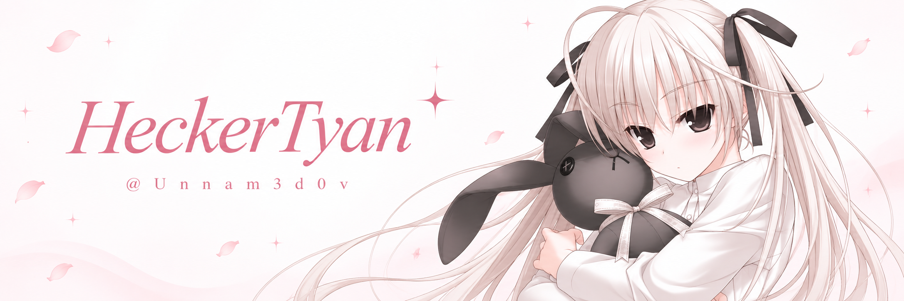

 

♡ &nbsp; SOFT PINK · ANIME SPACE &nbsp; ♡

# Привет, я HeckerTyan ♡

<a href="https://github.com/Unnam3d0v">@Unnam3d0v</a> &nbsp; / &nbsp; engineer by day, anime by night

Код, аниме и ещё одна хорошая идея перед сном.

 

 
 

**[репозитории ↗](https://github.com/Unnam3d0v?tab=repositories)** &nbsp; · &nbsp; **[сохраняю здесь ↗](https://github.com/Unnam3d0v?tab=stars)**

 

### 01 &nbsp; За кадром

Мой маленький уголок между кодом и титрами. Здесь — место для идей, экспериментов и вещей, которые хочется довести до ума.

Люблю момент, когда непонятное наконец складывается в работающую штуку. А если с первой попытки не вышло — значит, будет следующая серия.

 

### 02 &nbsp; В арсенале

  <code>C / C++</code> &nbsp; <code>ASM</code> &nbsp; <code>Rust</code> &nbsp; <code>Go</code>

  <code>Python</code> &nbsp; <code>Java</code> &nbsp; <code>Kotlin</code> &nbsp; <code>C#</code>

  <code>JavaScript</code> &nbsp; <code>TypeScript</code> &nbsp; <code>SQL</code> &nbsp; <code>Bash</code>

 

---

 

**「 У каждого проекта есть первая серия. 」**

спасибо, что заглянул · またね

 
 

✧ &nbsp; ♡ &nbsp; ✧

